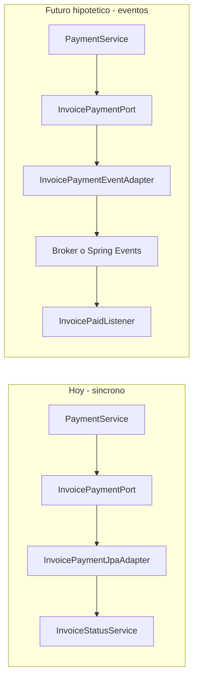

# ¿La arquitectura actual facilita eventos asíncronos entre módulos?

## Respuesta corta

**Parcialmente sí.** Los **puertos** ya separan el *contrato* (qué necesita un módulo) del *mecanismo* (cómo se obtiene hoy: JPA en un adaptador). Eso es el mismo “gancho” donde mañana podrías enchufar un adaptador que **publica eventos** en lugar de llamar en proceso.

**No es un cambio trivial ni “gratis”.** Los casos de uso están escritos como **orquestación síncrona** dentro de la misma transacción y la misma base PostgreSQL. Pasar a eventos implica rediseñar **consistencia**, **idempotencia** y varios flujos de **lectura**; no basta con sustituir el adaptador JPA por Kafka.

---

## Lo que ya ayuda (bien encaminado)

| Aspecto | Estado actual | Por qué ayuda para eventos |
|---------|---------------|----------------------------|
| Fronteras por puerto | RNF-013–016 implementados ([`InvoicePaymentPort`](backend/src/main/java/com/acueducto/veredal/payments/application/port/InvoicePaymentPort.java), [`WaterRightBillingPort`](backend/src/main/java/com/acueducto/veredal/invoices/application/port/WaterRightBillingPort.java), [`PortfolioReadPort`](backend/src/main/java/com/acueducto/veredal/portfolio/application/port/PortfolioReadPort.java), lookups en `waterrights`) | El consumidor depende de una **interfaz**, no de tablas ajenas. Un nuevo adaptador `*EventAdapter` puede implementar el mismo puerto o un puerto nuevo sin tocar JPA del otro módulo. |
| Snapshots/DTOs | `InvoiceForPayment`, `WaterRightBillingSnapshot`, etc. | Son candidatos naturales a **payload de evento** (versionados). |
| Adaptadores en el proveedor | p. ej. [`InvoicePaymentJpaAdapter`](backend/src/main/java/com/acueducto/veredal/invoices/infrastructure/payment/InvoicePaymentJpaAdapter.java) en `invoices` | Patrón hexagonal: el cambio de transporte se concentra en `infrastructure`, no en todos los servicios. |
| Un solo despliegue + una BD | Monolito | Fase 1 de “eventos” puede ser **in-process** (`ApplicationEvent` + `@TransactionalEventListener(AFTER_COMMIT)`) sin broker ni microservicios. |

**Esfuerzo bajo** si solo quisieras desacoplar *temporalmente* dentro del mismo JVM (mismo commit de BD, listener después del commit): sustituir o complementar adaptadores en ~6 cruces con puerto, sin cambiar contratos REST.

---

## Lo que hoy **no** está listo (coste real al ir a async)

### 1. Flujos de comando síncronos y transaccionales

Ejemplo crítico — [`PaymentService.create`](backend/src/main/java/com/acueducto/veredal/payments/application/PaymentService.java):

1. Lee factura vía `invoicePaymentPort.findForPayment`
2. Guarda pago
3. Llama `invoicePaymentPort.markPaidIfFullyCovered` **en la misma `@Transactional`**

El cliente HTTP espera que, al responder, la factura ya esté `PAID` si aplica. Con eventos “de verdad” (cola + otro hilo/proceso):

- Respuesta del API ≠ estado final inmediato (**consistencia eventual**)
- Hace falta **outbox** (o transacción de mensaje), **reintentos**, **consumidores idempotentes**
- Tests y QA cambian (estados intermedios, duplicados)

**Conclusión:** el puerto no evita este rediseño; solo localiza *dónde* publicar el evento.

### 2. Puertos de **lectura** no se reemplazan por eventos

[`PortfolioReadPort`](backend/src/main/java/com/acueducto/veredal/portfolio/application/port/PortfolioReadPort.java), [`WaterRightBillingPort`](backend/src/main/java/com/acueducto/veredal/invoices/application/port/WaterRightBillingPort.java), [`OwnerLookupPort`](backend/src/main/java/com/acueducto/veredal/waterrights/application/port/OwnerLookupPort.java) son **consultas**.

Para desacoplar lecturas con eventos necesitarías **CQRS / proyecciones** (tablas o vistas materializadas por módulo consumidor). Eso es **mucho más trabajo** que cambiar un adaptador de escritura.

### 3. Acoplamientos que **no** pasan por puerto

| Cruce | Tipo | Impacto en migración a eventos |
|-------|------|--------------------------------|
| [`TenantService`](backend/src/main/java/com/acueducto/veredal/tenants/application/TenantService.java) → `UserService` | Llamada directa `application` | Hay que extraer puerto o evento `TenantCreated` + listener en `auth` |
| `PortfolioService` → `InterestPolicyService` | Llamada directa | Igual; o mantener sync si es cálculo en línea |
| RNF-018 pendiente (`properties`/`auth`/`shared` → JPA ajeno) | JPA cruzado | Primero puertos; eventos después |

Sin cerrar [RNF-018](docs/stories/RNF-018-remaining-module-ports.md), el mapa de fronteras está incompleto.

### 4. Infraestructura inexistente

No hay `ApplicationEvent`, outbox, broker, esquema de eventos ni convención de nombres/versiones en el repo. Todo eso sería **nuevo**, no un refactor mecánico.

### 5. Base de datos compartida

Todos los módulos comparten PostgreSQL y Flyway. Los “módulos” son **lógicos**. Separar en servicios con eventos implica además:

- Fronteras de datos por servicio
- Sagas / compensaciones donde hoy hay una sola transacción
- Multitenancy (`tenant_id`) en cada mensaje y consumidor

Eso está **fuera** del alcance de “cambiar puertos por eventos” y es el salto más caro.

---

## Escenarios hipotéticos y esfuerzo relativo

| Escenario | ¿Factible? | Cambio de código | Notas |
|-----------|------------|------------------|-------|
| **A. Eventos in-process** (Spring, after commit, mismo monolito) | Sí | **Medio** (~6 adaptadores + listeners + tests de transacción) | Buen primer paso; no requiere Kafka. Puertos encajan bien. |
| **B. Broker interno** (Rabbit/Kafka, sigue un JAR) | Sí | **Medio-alto** | + outbox, observabilidad, DLQ, contratos de evento |
| **C. Microservicios** por módulo | Sí, pero caro | **Alto** | Puertos ayudan como borrador de API/eventos; hay que repartir BD, desplegar N servicios, API gateway, sagas |
| **D. Solo lecturas vía eventos** (cartera en tiempo real) | Posible | **Alto** | Proyecciones CQRS; los `*ReadPort` actuales seguirían existiendo hasta migrar datos |

**Orden recomendado si algún día lo hacen:** A → B (si hace falta escala) → C (solo módulos con presión real, p. ej. facturación/cobro).

---

## ¿Habría que modificar mucho código?

| Capa | ¿Cuánto cambia? |
|------|------------------|
| **Controllers / REST** | Poco, si se mantiene consistencia fuerte en la respuesta (escenario A con sync aparente) |
| **Application (casos de uso)** | **Medio** en comandos que hoy orquestan (pagos, batch facturas, alta tenant); poco en CRUD simples por módulo |
| **Infrastructure** | **Donde está el grueso**: nuevos adaptadores publicadores, listeners, outbox, métricas |
| **Tests** | **Medio-alto**: fakes de puerto ya existen; faltan tests de eventos, eventual consistency, idempotencia |
| **Documentación / ops** | ADR nuevo (eventos, outbox, versionado) |

Estimación cualitativa para **escenario A** (eventos in-process, sin microservicios): del orden de **varias historias técnicas** (no un refactor de un día), concentradas en 2–3 cruces críticos (`payments`↔`invoices`, batch facturación, opcional `tenants`↔`auth`).

Para **microservicios reales**: la arquitectura actual **no** lo hace “fácil”; los puertos reducen fricción en ~30–40% del trabajo (contratos y límites), el resto es distribución, datos y operación.

---

## Recomendación práctica (sin implementar ahora)

1. **Seguir con puertos síncronos** (cerrar RNF-018) — es la base correcta; no contradice eventos futuros.
2. Si se quiere **preparar** sin eventos aún:
   - Nombrar operaciones de puerto como intenciones de dominio (`markPaidIfFullyCovered` → podría ser reacción a `PaymentRecorded`)
   - Evitar nuevos `application` → `application` directos entre módulos
   - Documentar en un ADR futuro qué cruces serían **eventos de integración** vs **consultas**
3. **No** introducir broker hasta haya un caso de negocio que exija desacople temporal o escala (reprocesos, integraciones externas, equipos separados).

---

## Conclusión

La arquitectura **sí soporta mejor** un cambio a eventos que un monolito sin puertos (menos acoplamiento a JPA ajeno, contratos explícitos, adaptadores intercambiables). **No** está diseñada hoy para async: los flujos asumen **sync + misma transacción + lecturas en vivo**. El cambio sería **moderado** para eventos in-process en pocos cruces, y **grande** para async distribuido o microservicios.

No hace falta decidir ahora; los puertos son la inversión correcta para **mantenibilidad en el monolito**, con **opción** de eventos más adelante sin reescribir todo el dominio.
